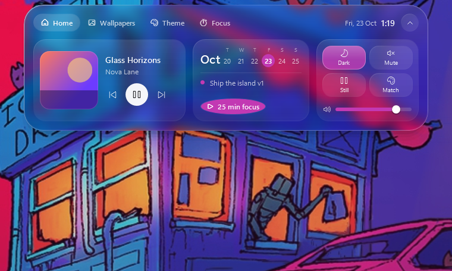

# Glass Island

A Dynamic-Island-style control center for Windows, rendered as **liquid glass**: one pill at the top of
your screen that morphs into a panel for wallpapers (Wallpaper Engine), theme, media and focus.



## Install

Glass Island is **one self-installing program**, `GlassIsland.exe`. Double-click it and choose **OK**. It
installs for your account only (no admin) to `%LOCALAPPDATA%\Programs\GlassIsland`, adds a **Glass Island**
Start menu entry, starts automatically when you sign in, and appears in **Settings → Apps** with an
**Uninstall** button. To update, run a newer `GlassIsland.exe` the same way; your settings, tasks and API key
are kept.

To build the program from source (needs the .NET 10 SDK; the program needs the .NET 10 Desktop Runtime):

```
powershell -ExecutionPolicy Bypass -File install.ps1            # builds dist\GlassIsland.exe
powershell -ExecutionPolicy Bypass -File install.ps1 -Install   # builds and installs it
```

**Autostart** uses a per-user Task Scheduler task ("GlassIsland", trigger *At log on*) instead of the
registry Run list, which Windows sometimes skips at sign-in. The task runs on battery and has no time
limit. Turn it on or off in Theme → Island → *Start with Windows*, or in Task Scheduler.

Requires Windows 10 (2004) or later and the [.NET 10 Desktop Runtime](https://dotnet.microsoft.com/download/dotnet/10.0).
To build from source with the .NET 10 SDK: `dotnet publish -c Release -o publish`.

| Action | How |
|---|---|
| Open / close | Click the pill, or the global shortcut. The app picks the first free one of **Ctrl+Alt+Space → Alt+\` → Ctrl+Alt+I → Ctrl+Shift+Space**; the Theme tab shows which one is active |
| Peek | Hover the pill (it grows and shows the song or timer label) |
| Out of the way | After 4 s untouched the pill **tucks into a slim line** at the top edge (or disappears entirely). Hover the top-centre edge to bring it back; click there to open the panel. The line shows focus progress, or the album colour while music plays |
| Fullscreen | In F11 browsers, fullscreen video and borderless games the island is invisible; **move the cursor to the top-centre notch area to bring it back**, and it hides again 1.2 s after you leave. Maximized windows don't count. Exclusive-fullscreen games, which nothing can draw over, hide it completely. Song pop-ups are muted in fullscreen |
| Open the player | Click the album art (in the pill, the Home card or a song pop-up), or the song title. The app that's playing comes to the front. For browsers it prefers the window showing the song or a music site, but it can't switch browser tabs |
| Close panel | Move the mouse away, press Esc, or click ⌃ |
| Quit | Theme tab → Quit |
| Autostart | Theme tab → *Start with Windows* |

## What's inside

**Pill (collapsed)** shows time and date, or the album art with live bars while music plays, or the focus
timer ring while a session runs. Short "live activities" appear for track changes, applied wallpapers,
theme switches and finished focus sessions.

**Album art** is decoded at the player's native resolution (up to 600 px) and drawn with high-quality
scaling. Some players hand Windows only a thumbnail; Firefox gives **60×60**. When that happens, the
island looks up the song's **600×600** artwork with Apple's iTunes Search API, trying the store for your
time zone, then your Windows region, then the US. It only uses a confident title and artist
match, and caches results per song. The lookup sends the song title and artist to Apple; turn it off in
Theme → Island → *HD album art (iTunes)*.

**Home** has now playing (any app that talks to Windows media controls: Spotify, browsers, Music…), a week strip
with your next task and a one-click focus session, plus quick toggles: Windows dark mode, mute, pause the
live wallpaper, match the accent to the wallpaper, and system volume.

**Wallpapers** shows every Wallpaper Engine wallpaper (workshop, *myprojects* and defaults) in a virtualized
grid: search by title or tag, filter by All / Favorites (★ on hover) / Recent (WE's own history), shuffle,
pause or play, mute, and pick the target monitor. The monitor numbers follow Wallpaper Engine's `-monitor`
order. Without Wallpaper Engine, images from `Pictures\Wallpapers` and `C:\Windows\Web\Wallpaper` are used.

**Theme** sets Light / Dark / Auto (Light 07:00–19:00), accent color swatches or *Match accent to wallpaper*,
transparency effects, accent on taskbar, and wallpaper rotation (off / 15 min / 30 min / 1 h / 3 h). Its
*Island* card holds the island's own behaviour: tuck delay (4 s / 8 s / 15 s / never), what's left when
tucked (a line or nothing), hide in fullscreen apps, liquid glass on/off, and start with Windows.

**Focus** has a Pomodoro ring (15 / 25 / 50 min) and a persistent task list.

## How the liquid glass works

1. The island window is excluded from screen capture (`WDA_EXCLUDEFROMCAPTURE`), so it can sample the
   screen *behind itself* without seeing itself.
2. A **background thread** grabs that region at **¼ resolution** (≈190×114 px) and blurs and saturates it.
   Screen reads take 6–15 ms, so they never run on the UI thread, where they used to cost animation frames.
3. Per island shape, a rounded-rectangle distance field **refracts the rim**: near the edge the glass
   samples the backdrop from further out, with slight chromatic dispersion. This lensing is what makes it
   read as *liquid* instead of frosted acrylic. It re-runs every frame while the island morphs.
4. A luminance-adaptive tint keeps white text legible over any wallpaper, and a sheen, inner glow and
   specular rim finish the material.

Motion is driven by damped **springs** (size, corner radius, tab indicator, tint), integrated in fixed
sub-steps so it feels the same at any refresh rate.

## Performance

Measured on a laptop with 16 logical cores and a 144 Hz display, Release build. CPU is % of **one core**.

| State | CPU | RAM (working set) |
|---|---|---|
| Tucked into the line | 0 % | ~30–70 MB |
| Pill at rest, music bars animating | ~1.2 % | same |
| Panel open, idle (glass live at 5 fps) | ~1.6 % | ~80–90 MB |

Frame pacing during interaction (`--bench`), before → after the performance pass:

| | Before | After |
|---|---|---|
| Expand: worst frame | 55 ms | 21 ms (steady 144 fps) |
| Open Wallpapers tab: worst frame | 111 ms | 21 ms |
| Scrolling 942 wallpapers: dropped frames | 9 | 0 |
| Memory churn per animation after scrolling | 20–48 MB | 0.4–2.3 MB |
| Full GCs during a session | 23 | 2 |

What made the difference:

- **No layered window.** WPF's `AllowsTransparency` copies every frame from the GPU back to the CPU. The
  window now uses DWM per-pixel transparency (`DwmExtendFrameIntoClientArea`) and stays on the GPU. A
  window region, updated twice per transition rather than every frame, keeps clicks passing through
  everywhere except the island.
- **Capture off the UI thread**, at 5 fps when open, 1 fps as a pill, and off when tucked or in fullscreen.
- **No per-frame effects.** The blur and drop-shadow effects are gone; the shadow and glow are built from
  plain translucent shapes, and static panels are bitmap-cached.
- **Fixed-slot wallpaper rows**, so list recycling only re-binds tiles, and panels are pre-built at idle
  after startup.
- **A disk thumbnail cache** (`%LOCALAPPDATA%\GlassIsland\thumbs`): each multi-MB preview is decoded once ever.
- **Background GC** in low-latency mode, plus a working-set trim 30 s after the panel closes.
- **Bug fixed:** the smooth-scroll loop could run forever if you switched tabs or closed the panel mid-scroll,
  keeping the whole app redrawing every frame. That was the main source of lag.

Turn off *Liquid glass island* (Theme tab) for a solid dark pill with zero capture cost. This also makes the
island visible in screenshots and screen recordings.

## Files

| Path | What |
|---|---|
| `MainWindow.xaml(.cs)` | Island window: springs, states, transitions, glass, input |
| `Core/BackdropCapture.cs` | Screen grab, blur, vibrancy, rim refraction |
| `Core/Spring.cs` | Spring physics |
| `Services/WallpaperService.cs` | Wallpaper Engine discovery, index cache, `-control` commands, thumbnail loader |
| `Services/ThemeService.cs` | Dark mode, accent palette, transparency, autostart (HKCU only, no admin) |
| `Services/MediaService.cs` | Now playing via Windows media controls |
| `Services/AudioService.cs` | System volume via Core Audio |
| `ViewModels/MainViewModel.cs` | Clock, wallpapers, theme, focus and tasks |
| `Styles/Glass.xaml` | Glass buttons, chips, switches, slider, scrollbars |

Settings, the wallpaper index and a small log live in `%APPDATA%\GlassIsland`.

## Developer flags

```
GlassIsland.exe --snapshot <dir> [--demo] [--backdrop <image>]
```

Renders every state (pill, hover, home, wallpapers, theme, focus, timer, toast) to PNGs and exits.
`--demo` fakes a playing track, tasks and a running timer. `--backdrop` renders over an image instead of
the live screen.

```
GlassIsland.exe --bench <report.txt>
```

Drives the real window through hover, expand, every tab, wallpaper scrolling, collapse and tuck. Writes
frame pacing, capture time, CPU, GCs and allocations per phase, plus the top allocating types to
`<report.txt>.alloc.txt`.

Set `GI_TRACE=1` to log state transitions. `GI_SHOWINCAPTURE=1` lets screenshots see the window, to check
how it composites on screen.
